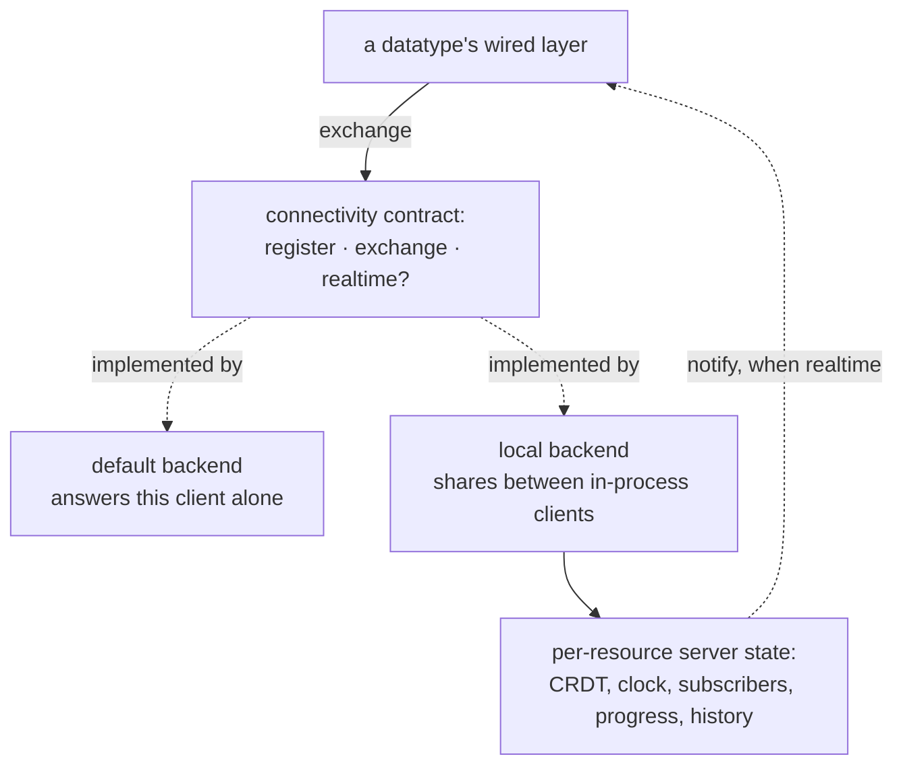

# Connectivity

Connectivity is the seam between a datatype and whatever it synchronizes through. Everything
above it — transactions, convergence, lifecycle — is the same regardless of what sits below,
and everything a backend has to do is expressed as one exchange: take what this client has,
return what it should know. This document defines that contract, what a backend is obliged to
honor, and what the two bundled implementations do. It does not define the schedule on which
exchanges happen; see [`docs/event-loop.md`](event-loop.md).

## Model

| Term | Meaning |
|------|---------|
| Backend | An implementation of the connectivity contract that a client exchanges through |
| Exchange | One call carrying what the client has and returning what the backend answers |
| Package | The value carried in both directions of an exchange, naming the datatype and holding the work |
| Resource | The datatype a package refers to, addressed by collection and key |
| Registration | Attaching a datatype to the backend so it can be notified of work from elsewhere |
| Realtime | Whether the backend tells clients when work arrives, rather than waiting to be asked |
| Progress | The pair of sequence numbers describing how far a client and the backend have acknowledged each other |

A backend is asked for three things: to accept a registration, to perform an exchange, and to
say whether it is realtime. Everything else — how it stores data, whether it is in this process
or across a network, how it decides what to return — is the backend's own business.

## Rules and Guarantees

**One exchange carries everything.** A package names its resource, the client sending it, that
datatype's state, its progress, and the transactions it wants accepted. The response is another
package, carrying what the client should apply and either the new state or an error. There is
no separate handshake and no partial exchange.

**A resource is addressed by collection and key.** Both bundled backends look up their state by
that pair, so two clients converge exactly when they use the same collection and key.

**The datatype's state drives the exchange.** A backend dispatches on the state the client
declares — creating, subscribing, subscribing-or-creating, subscribed, unsubscribing — and its
answer is what moves the datatype's lifecycle forward. Every backend must honor the state set
defined in [`docs/datatype-state.md`](datatype-state.md).

**Progress decides what is sent and what is skipped.** A client sends the transactions the
backend has not acknowledged, and the backend returns those the client has not seen. A
transaction the client already applied is skipped rather than applied twice.

**The push buffer holds unacknowledged work.** After the response is successfully applied,
the client advances its checkpoint and removes whole buffered transactions up to the
acknowledged `cseq`, freeing their accounted buffer capacity. Partial acknowledgements
retain the remaining transactions for the next request; repeated acknowledgements remove
nothing twice. A lost response or failed response application does not advance the
checkpoint or reclaim the batches. Snapshot replacement and error recovery retain their
own reset policies; this rule does not make remote CRDT application atomic on failure.

An acknowledgement cannot exceed the client sequence sent in that request, including when
new local writes finish during network exchange. Response checkpoints must not regress,
and server progress must cover the newly acknowledged client transactions. Invalid progress
is rejected before applying the response and follows the protocol-error recovery policy in
[`docs/error-handling.md`](error-handling.md). The buffer retains its last accepted `cseq`
when empty, so sequence checks still apply to the next enqueue.

**Registration is what makes notification possible.** A datatype registers with the backend
when its event loop starts, handing over the channel the backend can use to tell it that work
has arrived. A backend that is not realtime never uses it.

**The notification itself is never dropped; what it triggers can be.** Registration hands the
backend a channel that does not drop what is sent to it, so a realtime backend's "a push
succeeded" reaches every registered client. What each client does in response is its own
decision — checking whether the notification means there is actually anything new to pull, and
if so, asking its own event loop to check again — and that second, client-local step is the one
allowed to be dropped if one is already pending. See
[`docs/event-loop.md`](event-loop.md) for exactly which channel that is and why.

**Errors come back inside the package.** A backend that refuses reports the reason in the
package rather than by failing the call, so the client can tell a refusal apart from an
unreachable backend. Both become typed errors with recovery actions; see
[`docs/error-handling.md`](error-handling.md).

**Limits on the guarantees.** The default backend is not a network: it answers the calling
client and shares nothing, so two clients built with it never converge. The local backend
shares only within one process. Neither is a durable store — nothing survives the process. The
backend contract is also not yet a public extension point: its error type stays internal, so an
out-of-process backend is possible in shape but not yet supported as published API.

## The bundled backends

**The default backend** is what a client gets when none is supplied. It holds no state and
answers from the declared state alone: a creating or subscribing-or-creating datatype becomes
subscribed, a subscribing one is accepted only if it brings no transactions, an unsubscribing
one becomes disabled, and a readonly client attempting to create is refused. It reports itself
as realtime. It exists so that building a client works with no backend wired up, and so tests
and examples that do not need sharing do not have to set one up.

**The local backend** simulates a server for clients in one process. It keeps per-resource
state created the first time a datatype registers for that resource, and it can be switched
between realtime and manual. Each resource groups its CRDT, maximum accepted Lamport time,
server sequence, client progress, and transaction history in `SyncedState`. That state owns
batch acceptance, history pulls, and snapshot generation. `LocalDatatypeServer` manages
resource identity, lifecycle, and notifications. Its DUID is nil until a creation request
succeeds; creation requests with a nil DUID are rejected before changing backend state.
Registration alone does not create the resource, and creation can succeed without transactions.
Active logical subscriptions are stored in
`SyncedState.checkpoints`: each entry pairs accepted client `cseq` with reported applied
server `sseq`. Readonly and empty subscriptions also have entries; unsubscribe removes the
entry, clearing both progress boundaries together.

Datatype deletion is unsupported. A direct `Deleting` request to the local backend returns
`ProtocolViolation("datatype deletion is not supported")` with response state `Disabled`.
It does not execute attached transactions or change resource state, subscriptions, or
registrations. This rejection does not implement a delete lifecycle.

New transactions are executed in server order against an isolated O(1) fork of the backend CRDT.
Only a completely valid request batch publishes the CRDT, clock, history, and acknowledgement
progress. A failed batch leaves those fields unchanged; a failed creation does not publish a
created resource. Transactions at or below the client sequence accepted before this request
are ignored as retransmissions. The remaining transactions must have consecutive increasing
client sequences; duplicates, backward sequences, or gaps reject the entire batch.
Responses continue to exclude the requesting client's own transactions.
When a subscription ends, its client-sequence deduplication entry is removed after the final
push is processed. A fresh subscription from the same client can therefore start its local
sequence at zero without inheriting the previous subscription's accepted sequence.

Push `checkpoint.sseq` acknowledges the last server boundary successfully applied by that
client. Pull `checkpoint.sseq` reports the server head; sending it does not acknowledge client
application. The backend trusts each client's reported applied boundary and tracks it
monotonically per subscription, without tracking which responses it previously provided.
The reported boundary must not exceed the server head before the request is processed.
This bound is checked separately from identity, with the same protocol error message across
creation, subscription, and active-subscription processing.
A new subscription must start with checkpoint zero. Identity, progress, and batch validation
must succeed before its applied boundary advances. Clients must report only successfully
applied state: an incorrect acknowledgement can advance the safe boundary prematurely and
make future history pruning discard transactions that client still needs.

Pull `safe_sseq` is the minimum applied boundary across all logical subscribers, including the
requesting client and readonly subscribers. With no subscribers it is the server head. Wired
registration alone does not enter this calculation. A new subscription starts at the existing
safe boundary; resending its snapshot preserves its previous applied boundary. Client-provided
`safe_sseq` is not trusted or reflected. Unsubscribe processes the final push, removes the
subscription and its sequence metadata, and recomputes safe over the remaining subscribers.
`LocalDatatypeServer::process` creates the response, converts state-specific errors into
Disabled responses, and sets final `safe_sseq`. Private state-specific processors update
the shared response and return `PushPullError` on rejection. Creation, subscription, and
client-push validation use read-only helpers before backend mutations. Unsubscribe cleans up
its subscription even when its final push is rejected.
Failed final batches retain the existing unsubscribe cleanup behavior without acknowledging
that batch. These acknowledgements do not remove history or perform tombstone GC.

A creation retried after a lost pull receives intervening transactions from other clients as
well as its deduplicated client checkpoint. This also applies to subscribe-or-create retries
of the creating client, which retain creation semantics instead of replacing local state with
a subscription snapshot.

A subscription receives a snapshot serialized from the backend's accepted CRDT, with its
server `sseq` and Lamport clock captured under the same resource lock. Snapshot bytes are
created on subscription, not on every push. The boundary includes successfully accepted
transactions even if their originating client lost its response. It excludes edits that have
not been sent. The snapshot transaction's envelope CUID is nil; originating CUIDs inside CRDT
conflict metadata are preserved, and the subscriber retains its own local identity.

Snapshot generation never acquires a client's transaction gate, invokes client callbacks, or
looks for a live provider. Registrations hold weak wired references, so dropping client
handles preserves backend state and history without retaining client runtime ownership.
Explicitly removing all subscriptions and registrations discards the resource. See
[Runtime Resources](runtime-resources.md#shutdown-and-backend-ownership).

A test-only interceptor can wrap a single datatype's exchanges, inspecting or altering what goes
out and injecting an error on what comes back. It is reachable only from test builds.

## Behavior

**Two clients sharing a datatype.** Both build a datatype with the same collection and key
against the same local backend. The first to push creates the backend resource. The second
receives its accepted-state snapshot. From there each new transaction reaches the other client
either on notification or at the next exchange.

**A datatype with the default backend.** Every exchange succeeds and moves the lifecycle
forward, so the datatype reaches subscribed and stays writable, but nothing it pushes reaches
another client and nothing arrives. This is the shape most surprising to a new reader: the
datatype looks fully functional and shares nothing.

**A backend that is switched to manual.** Nothing is pushed until the application asks for a
synchronization. This is what makes an ordering deterministic in a test — with realtime on, a
push can happen before a handler is registered.

**A client that leaves.** Existing clients may unsubscribe or lose their wired instances.
Later subscriptions still receive the backend snapshot while the resource remains retained.
No client is promoted to snapshot provider.

**A refusal.** The backend rejects a push — a type mismatch, a client that is not subscribed, a
protocol violation — and returns the reason in the package. The client turns it into a typed
error whose recovery action disables the datatype.

## Rationale

**The backend is a contract, not a fixed set of choices.** Synchronization is the part most
likely to be replaced: a different transport, a different server, a test double. Expressing it
as something to implement rather than as a closed set of alternatives means adding one does not
touch the datatype layers at all.

**The whole exchange is one call.** A backend that could be asked several questions per
synchronization would have to define what happens when only some of them succeed. One call with
one package makes an exchange atomic from the client's point of view: it either has an answer to
apply or an error to route.

**Refusals travel inside the package rather than as call failures.** "The backend said no" and
"the backend could not be reached" need different recoveries — one is permanent, the other is
worth retrying. Keeping them in different channels means the client does not have to
reverse-engineer which happened from an error string.

**The backend owns subscription state.** A client's current value can contain unsent edits.
Maintaining one accepted CRDT per backend resource provides consistent subscription snapshots
without keeping a second CRDT per client, echoing self transactions, or replaying the entire
history on each subscription. The backend pays one extra operation execution per accepted
operation and keeps a temporary CRDT candidate while validating a new batch. It does not keep
a client runtime or pre-serialize snapshot bytes on each write. CRDTs do not implement `Clone`;
`fork_for_batch` explicitly copies scalar metadata and shares immutable payloads. Every added
CRDT must implement this O(1) contract without copying its collections, including a deferred
full copy on the first batch write. Variable tests check
payload pointer sharing and that a candidate write leaves its source state unchanged.

**A client is allowed to drop its own follow-up check, not the notification that caused it.**
Queuing every follow-up would turn a burst of notifications into unbounded memory on the
receiving client for no benefit, since one pending check already promises the next exchange
will happen. Because progress is compared on every exchange rather than trusted from the
notification's payload, a dropped follow-up delays convergence but cannot break it.

**The interceptor is reachable only from tests.** Nothing in production has a reason to alter an
exchange in flight. Gating the way to obtain it, rather than the type, keeps the wired layer
free of conditional compilation while still keeping the capability out of production builds.

## Code Map

| Concern | Location |
|---------|----------|
| The backend contract: register, exchange, realtime | `src/connectivity/mod.rs` |
| The package exchanged in both directions, and how a resource is addressed | `src/types/push_pull_pack.rs` |
| The default backend | `src/connectivity/null_connectivity.rs` |
| The local backend and its per-resource map | `src/connectivity/local_connectivity.rs` |
| Per-resource state: CRDT, clock, subscribers, progress, history, and the per-state handling | `src/connectivity/local_datatype_server.rs` |
| The test-only exchange interceptor | `src/datatypes/wired_interceptor.rs` |
| The caller: building the outgoing package and applying the response | `src/datatypes/wired.rs`, `src/datatypes/pull_handler.rs` |

| Verified by | Tests |
|-------------|-------|
| Invalid operation batches leave backend state and progress unchanged | `can_reject_a_late_batch_failure_without_advancing_backend_state`, `can_keep_a_failed_creation_unpublished` in `src/connectivity/local_datatype_server.rs` |
| Subscription is independent of client lifetime and transaction gates | `can_serve_a_snapshot_without_accessing_client_state` in `src/connectivity/local_datatype_server.rs` |
| Subscription includes accepted work before its creator applies the response | `can_subscribe_before_the_creator_applies_its_accepted_response` in `src/connectivity/local_datatype_server.rs` |
| Unsent edits do not leak into new subscriptions | `tests/snapshot_state.rs` |
| Two clients converge over a shared backend | `can_sync_bidirectionally_between_two_clients` in `src/connectivity/local_datatype_server.rs` |
| Each declared state is handled | `can_process_creating`, `can_process_subscribing`, `can_process_subscribe` in `src/connectivity/local_datatype_server.rs` |
| Refusals: unsubscribed pusher, type mismatch, disabled client, readonly with work | `can_reject_subscribed_push_from_unsubscribed_client`, `can_reject_type_mismatch_in_subscribed_push`, `can_reject_push_from_disabled_client`, `can_reject_readonly_unsubscribing_with_transactions` in `src/connectivity/local_datatype_server.rs` |
| Unsubscribing a client that was never subscribed is not an error | `can_unsubscribe_not_subscribed_client_gracefully` in `src/connectivity/local_datatype_server.rs` |
| Backend snapshots survive removal of client registrations | `can_subscribe_from_backend_state_after_clients_are_removed` in `src/connectivity/local_datatype_server.rs` |
| A creator can unsubscribe without changing snapshot ownership | `can_keep_serving_snapshots_after_the_creator_unsubscribes` in `src/connectivity/local_connectivity.rs` |
| Per-resource state is discarded when the last client leaves | `can_remove_server_when_last_client_unsubscribes` in `src/connectivity/local_connectivity.rs` |
| Realtime and manual differ in when work moves | `can_compare_manual_and_realtime_local_connectivity` in `src/connectivity/local_connectivity.rs` |
| A realtime push notifies the other clients | `can_notify_other_clients_after_realtime_push` in `src/connectivity/local_connectivity.rs` |
| The default backend's answers, including its edge cases | `can_deal_with_edge_cases_in_null_connectivity` in `src/connectivity/null_connectivity.rs` |

## Related Concepts

- [`docs/architecture.md`](architecture.md) — where the exchange sits and which lock is held around it
- [`docs/event-loop.md`](event-loop.md) — what schedules an exchange and how notifications are consumed
- [`docs/datatype-state.md`](datatype-state.md) — the states a backend dispatches on and the transitions it may answer with
- [`docs/error-handling.md`](error-handling.md) — how a refusal and an unreachable backend become different recoveries
- [`docs/transaction-and-rollback.md`](transaction-and-rollback.md) — the transactions an exchange carries
- [`docs/core-types.md`](core-types.md) — the identities and sequence numbers a package carries
