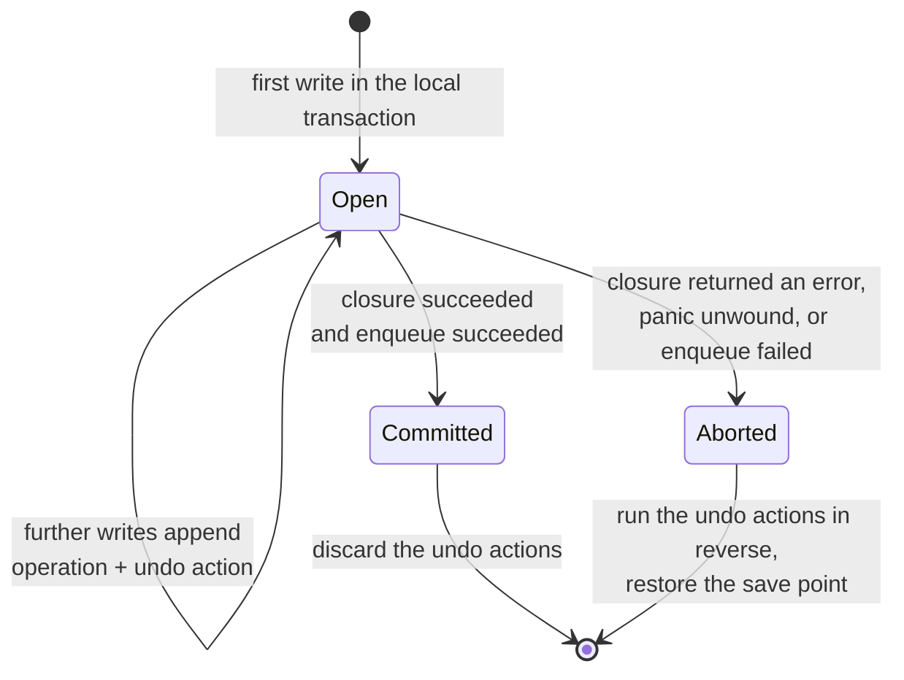
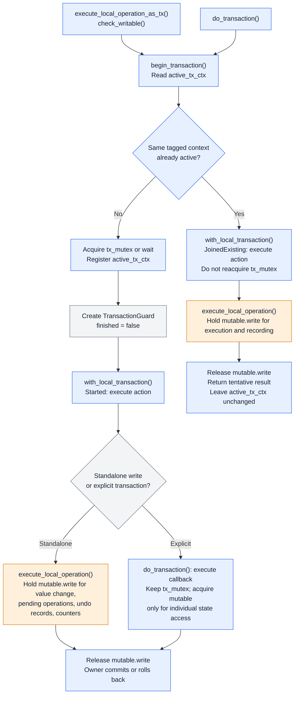
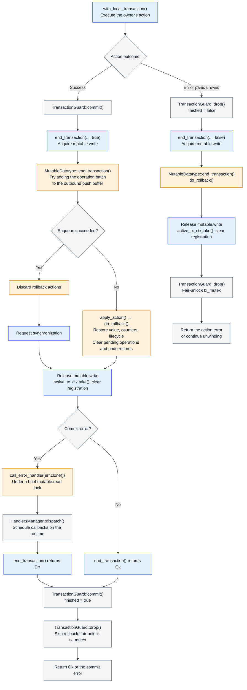
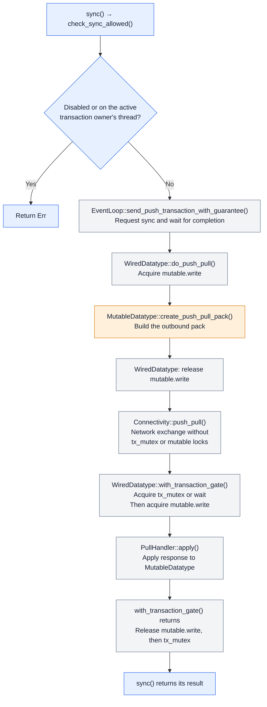

# Transaction and Rollback

A transaction is the unit in which local changes to one datatype become visible and become
eligible for synchronization. Every local write happens inside one, whether the application
asks for it or not: a single write runs in its own local transaction, and several writes can be
grouped into one local transaction that either takes effect completely or leaves no trace. This
document defines how a local transaction begins, what happens when two threads want one at the
same time, and how an aborted local transaction is undone. It does not describe how a committed
transaction reaches other clients — see [`docs/event-loop.md`](event-loop.md) and
[`docs/connectivity.md`](connectivity.md) for that.

## Model

| Term | Meaning |
|------|---------|
| Transaction | The recorded batch of operations that is enqueued after a successful commit |
| Local transaction | One unit of local work on a datatype, from admission through commit or rollback |
| Standalone write | A write made outside an explicit transaction, which opens and closes a local transaction of its own |
| Transaction context | The token that identifies one local transaction, so a write can tell whether it belongs to the local transaction already open |
| Pending transaction | The operations recorded so far in the open local transaction, in the form that will be sent to other clients |
| Rollback action | A local-only instruction that undoes one applied operation; never sent to other clients |
| Save point | The progress counters and lifecycle state captured when the local transaction opened, restored if it is undone |

A datatype has at most one open local transaction at a time. Operations accumulate into the
pending transaction as they succeed, each paired with the action that would undo it. Finishing
the local transaction resolves both: a commit hands the pending transaction to the push buffer
and throws the undo actions away, while a rollback runs the undo actions and throws the pending
transaction away.

Rollback is by recorded inverse, not by snapshot. Nothing keeps a copy of the CRDT value, and
nothing about undoing is ever serialized — a rollback action exists only on the client that
created it, and only until its local transaction closes.

## Rules and Guarantees

**Local transaction.** A write outside an explicit transaction starts a local transaction,
applies its operation, and finishes the transaction before returning. An explicit transaction
starts one local transaction around a closure; writes made through the handle the closure
receives join it rather than starting their own. The local transaction finishes when the
closure returns.

**Atomicity.** A local transaction commits only if the closure returns success. If it returns
an error, every operation already applied in that local transaction is undone and the
datatype is restored to its save point. A failed operation that the callback handles does
not automatically abort earlier successful operations. A commit rejection also rolls back
the transaction. The batch is enqueued whole or not at all.

**Concurrency.** A thread that asks to start a local transaction while another thread owns one
waits until the active transaction finishes, then proceeds. Admission does not reject a
caller merely because another transaction is active. Writes within one local transaction are serialized against each other, so operations
accumulate in a defined order.

**Local transaction ownership and waiting.** Every local transaction, including a standalone
write, owns a transaction mutex guard. A tagged operation first checks whether its context is
already active and joins it if so. Every other caller waits for the transaction guard, then uses
the acquired guard directly to register and own the next local transaction. It does not release
the mutex and race through a separate context check. The guard explicitly commits successful
local work; its Drop rolls back unfinished work.
Both paths clear the active context before releasing the mutex, so the same wait covers the gaps
between operations as well as cleanup. Fair mutex handoff reduces barging but does not promise
FIFO admission of local transactions.

An operation joining the active context acquires the mutable-state write lock for its value
change, rollback record, and counter update. Concurrent operations sharing that context execute
one at a time under this lock. A standalone handle's default context is replaced with a fresh
identity for each new local transaction, so concurrent standalone writes cannot accidentally
join each other. Unwinding releases the mutable-state lock before transaction rollback and
context cleanup release the transaction guard.

The wired layer shares the transaction mutex. Network exchange remains outside it, but applying
a remote response waits until the open local transaction has committed or rolled back. The same
gate covers response snapshots, lifecycle changes, error recovery, and snapshots served to new
subscribers, so local rollback cannot erase a remote change applied during the transaction.
Synchronous `sync()` is rejected on the thread that owns the active local transaction, including
calls through a captured original handle, because its response cannot be applied until the
callback finishes. Calls from other threads can exchange with the backend and wait for the gate
before applying the response. The owner thread must not wait for another thread to finish
`sync()` on the same datatype: that indirect circular wait is not detected.

Reads do not acquire the transaction mutex. The mutable-state lock protects each individual
state access and is released between local operations and across the user closure's own work, so
another handle can observe values written by a transaction that has not committed yet.

**Progress counters.** A datatype's operation counters advance only after an operation
succeeds. A failed operation leaves them untouched, and the next operation takes the slot the
failed one would have used. Committing a transaction advances the transaction sequence once,
however many operations it contained; each successful operation advances the logical clock.

**Save point.** The counters and lifecycle state are captured when the first operation of a
local transaction is recorded, rather than when the transaction is requested. An undo restores
exactly that snapshot, so a datatype that rolls back is indistinguishable from one where the
local transaction never began.

**Undo order.** Rollback actions are applied in reverse of the order their operations were
applied, so an operation is undone before anything it depended on.

**Enqueue.** A committed transaction is enqueued for synchronization only if it originated on
this client. Transactions are enqueued in sequence, and a gap in that sequence is rejected
rather than accepted out of order. Buffered transactions stay in the buffer until the backend
acknowledges them; see [`docs/connectivity.md`](connectivity.md).

**Success and tentative results.** A standalone write returns `Ok` only after its local
transaction commits. An explicit `transaction` returns `Ok(())` only after all recorded
operations are accepted into the push buffer. A capacity or sequence rejection rolls back
the transaction and returns its `DatatypeError`; the error handler also receives one
notification. Values returned by operations inside a transaction callback are tentative
until the enclosing `transaction` returns success. Local commit does not mean the server
has acknowledged the transaction. Atomicity is per datatype: there is no local transaction
spanning two datatypes.

## Behavior

**A standalone write.** `counter.increase_by(1)` starts a local transaction, applies the
operation to the CRDT, records the operation and its undo action, advances the counters, and
attempts to enqueue the recorded transaction holding that one operation. Only after local
commit succeeds does the write return the new value; a commit rejection rolls it back and
returns an error.

**An explicit transaction that commits.** `counter.transaction("tag", |c| { … })` opens one
local transaction and hands the closure a handle carrying that transaction's context. Each write
through that handle joins the active local transaction instead of starting its own. When the
closure returns success, the local transaction commits and all the operations are enqueued as
one transaction with one sequence number.

**An explicit transaction that aborts.** The closure returns an error after two successful
writes. Both are undone in reverse order, the counters and lifecycle state return to the save
point, and the transaction is never enqueued. The datatype's value is what it was before the
closure ran, and the call reports the error.

**An operation that fails mid-transaction.** A write inside the closure returns an error — an
invalid value, or a state that does not permit writes. That operation applied nothing, so no
undo action is recorded for it and the counters do not advance. The closure decides whether the
local transaction continues: if it propagates the error, the transaction rolls back and the
earlier writes are undone; if it handles the error and returns success, the transaction commits
with the operations that did succeed.

**A commit that fails to enqueue.** The closure returned success, but the push buffer rejects
the transaction. The transaction is restored so its undo actions still match, the local
transaction rolls back, and the owning standalone write or explicit transaction returns
the enqueue error. The error handler receives one additional notification. Results observed
inside the callback remain tentative until its enclosing transaction commits.

**A datatype that is disabled or unsubscribed with work pending.** Buffered transactions are
not discarded by a lifecycle change on their own; what happens to them is decided by the
recovery action for the triggering error, described in
[`docs/error-handling.md`](error-handling.md).

## Execution and Lock Flow

The diagrams name the functions responsible for each step. Blue nodes belong to
`TransactionalDatatype`, orange nodes to `MutableDatatype`, and gray nodes to other
types or caller outcomes. Color identifies the executing type, not the owner of a lock.
`TransactionGuard` owns the local transaction's `tx_mutex` guard; `active_tx_ctx` records
its context and owning thread. The `active_tx_ctx` read/write locks are brief and do not
span the callback.

### Entry and joining

Public transaction wrappers check writability before `do_transaction`. Only operations
sharing the same tagged context object can join; matching tag strings alone do not suffice.
A joined operation releases its mutable-state lock and returns a tentative result without
finishing the enclosing transaction.

### Commit, rollback, and notification

Both completion paths clear `active_tx_ctx` before releasing `tx_mutex`. Removing that
registration drops its `ActiveTransactionContext`; other `Arc` references can keep the
underlying `TransactionContext` alive. `finished = true` means explicit completion has
finished, including rollback after a commit rejection, rather than that commit succeeded.

Commit-error callbacks are scheduled after context cleanup but before the guard releases
`tx_mutex`. Their actual execution can begin before or after that release. A callback
starting a new write waits for the gate if necessary. Callback and operation errors retain
their existing caller-return policy; this notification path is for commit rejection.

### Sync and remote response application

`sync()` does not register an active local context. The wired layer shares `tx_mutex` but
holds it only for response application, recovery, or subscriber snapshot generation, not
network exchange. This diagram shows the successful response path; a failed exchange uses
`WiredDatatype::handle_error` and the same gate for recovery.

## Rationale

**Undo is recorded, not snapshotted.** Keeping a copy of the CRDT value before each local
transaction would cost memory proportional to the value rather than to the change. For a
datatype that is mostly read and rarely rolled back, that cost is paid on every write. Recording one action per
applied operation costs only what the local transaction actually changed.

**Undo actions never reach the wire.** A rollback is a local decision about work that no other
client ever saw. Putting undo information into the operation would grow every message with data
only the originating client can use, and would let a peer replay a rollback that means nothing
in its own history.

**Counters advance only on success.** The alternative — advance first, revert on failure — needs
a correct revert path for every failure mode, including ones that occur between advancing and
detecting the failure. Advancing after success means a failed operation needs no cleanup at all:
the state it would have changed was never changed.

**A guard carries the right to finish the local transaction.** The local transaction owns the
transaction guard, while each operation holds the mutable-state write lock. A waiter becomes
the next owner only after acquiring the previous local transaction's mutex guard. Transaction
cleanup never infers ownership from whether a mutex happens to be locked. Each operation
releases its mutable-state lock before transaction cleanup takes it again to commit or roll back.

**The save point is captured at the first recorded operation, not when the local transaction
begins.** A local transaction that finishes without applying anything has nothing to restore,
and capturing at admission would make every empty transaction carry a snapshot it never uses.

**Each CRDT owns its own action type.** The top-level rollback action has one variant per CRDT
rather than one per operation, and only the CRDT wrapper matches an action family to a CRDT
instance. Adding a datatype adds one variant and touches no existing rollback code.

**Some operations restore rather than invert.** An increment can be undone by adding its
inverse, but a last-writer-wins assignment cannot: the new value carries no trace of what it
replaced. Those operations capture the previous state in their undo action instead. Both shapes
satisfy the same rule — the action restores what the operation changed — so the local
transaction logic does not need to know which shape it holds. See
[`docs/variable.md`](variable.md).

## Extending: adding a local operation

A new local operation has to implement two halves that fit together, at the concrete CRDT
level:

1. **Local execution** locates its target once, captures whatever the undo needs, applies the
   change, and returns both the caller-facing value and the undo action.
2. **Undo application** restores what that operation changed.

An error from local execution must leave the CRDT untouched, because a failed operation records
no undo action and nothing will be run to clean up after it. Remote execution is a separate
path: it applies an operation that already happened elsewhere and never produces an undo action,
because a remote transaction is never rolled back locally.

## Code Map

| Concern | Location |
|---------|----------|
| `TxRecord` — pending transaction, undo actions, and the save point | `src/datatypes/tx_record.rs` |
| Applying an operation, recording it, and advancing the counters | `src/datatypes/mutable.rs` (`execute_local_operation`) |
| Closing a local transaction: enqueue on commit, undo on abort | `src/datatypes/mutable.rs` (`end_transaction`, `do_rollback`) |
| Opening and joining local transactions, waiting for a local transaction held elsewhere | `src/datatypes/transactional.rs` (`begin_transaction`, `execute_local_operation_as_tx`, `do_transaction`) |
| Success handling for owned or joined local work, cleanup, and active-context ownership | `src/datatypes/transactional.rs` (`with_local_transaction`, `TransactionGuard`) |
| Waiting to apply remote responses, recovery, and subscriber snapshot generation after local transaction cleanup | `src/datatypes/wired.rs` (`with_transaction_gate`) |
| The public `transaction(tag, closure)` entry point | `src/datatypes/counter.rs`, `src/datatypes/variable.rs` |
| Sequence checks and capacity limits on enqueue | `src/datatypes/push_buffer.rs` |
| Undo action families and the wrapper that routes them | `src/datatypes/crdts/` |
| Counter arithmetic and its inverse | `src/datatypes/crdts/counter_crdt.rs` |

| Verified by | Tests |
|-------------|-------|
| A transaction commits as a unit; an aborted one leaves no trace | `can_use_transaction` in `src/datatypes/counter.rs` |
| Concurrent operations sharing one context preserve values, counters, batch boundaries, rollback, and subsequent progress | `can_serialize_concurrent_operations_in_one_transaction` in `src/datatypes/transactional.rs` |
| Concurrent transactions from several threads all complete | `can_run_transactions_concurrently` in `src/datatypes/counter.rs` |
| A standalone local transaction excludes competing writes and transactions until commit | `can_hold_standalone_transaction_until_commit_before_admitting_waiters` in `src/datatypes/transactional.rs` |
| Commit, callback error, panic, and enqueue rejection finish cleanup before the next write | `can_finish_transaction_cleanup_before_releasing_waiters` in `src/datatypes/transactional.rs` |
| An invalid standalone operation releases its mutable-state lock and transaction guard | `can_release_standalone_locks_after_operation_failure` in `src/datatypes/transactional.rs` |
| Operations and undo actions accumulate and are taken together | `can_record_and_take_rollback_actions` in `src/datatypes/tx_record.rs` |
| A failed operation leaves the local transaction and counters unchanged | `can_preserve_transaction_state_when_operation_execution_fails` in `src/datatypes/mutable.rs` |
| Undo actions live exactly as long as their local transaction | `can_manage_rollback_action_lifetimes` in `src/datatypes/mutable.rs` |
| Capacity and sequence rejections return errors, restore state, and permit subsequent writes | `can_return_commit_failure_and_resume_writes` in `src/datatypes/transactional.rs` |
| Propagated operation errors roll back; handled errors permit earlier writes to commit | `can_resolve_transaction_after_operation_error` in `src/datatypes/transactional.rs` |
| An empty transaction succeeds without adding a batch | `can_finish_empty_transaction_without_enqueue` in `src/datatypes/transactional.rs` |
| A remote Variable set waits for local rollback and remains the winner afterward | `can_preserve_remote_variable_set_after_local_transaction_rollback` in `src/datatypes/wired.rs` |
| Sync on the owner thread is rejected through both callback and original handles | `can_reject_sync_on_the_local_transaction_owner_thread`, `can_reject_sync_from_both_handles_inside_a_transaction_callback` in `src/datatypes/transactional.rs` |
| Sync from another thread exchanges during the callback and completes after rollback | `can_complete_sync_from_another_thread_after_local_rollback` in `src/datatypes/transactional.rs` |
| Counter undo, including the self-inverse extreme | `can_return_and_apply_a_counter_rollback_action` in `src/datatypes/crdts/counter_crdt.rs` |
| Restore-shaped undo is routed to the right CRDT | `can_dispatch_local_variable_execution_and_rollback` in `src/datatypes/crdts/crdt.rs` |
| Restoring the save point returns the counters exactly | `can_next_rollback_compare_operation_ids` in `src/types/operation_id.rs` |
| Buffered transactions survive an unsubscribe | `can_unsubscribe_with_pending_transactions` in `src/datatypes/datatype.rs` |

## Related Concepts

- [`docs/architecture.md`](architecture.md) — where the transactional layer sits and what it shares with synchronization
- [`docs/core-types.md`](core-types.md) — the logical clock and transaction sequence the counters carry
- [`docs/datatype-state.md`](datatype-state.md) — the lifecycle states that permit or refuse writes
- [`docs/variable.md`](variable.md) — the restore-shaped undo and why assignment is not invertible
- [`docs/error-handling.md`](error-handling.md) — recovery actions, including the one that undoes a transaction
- [`docs/handler-system.md`](handler-system.md) — how a commit failure reaches the application
- [`docs/connectivity.md`](connectivity.md) — what happens to a transaction after it is enqueued
